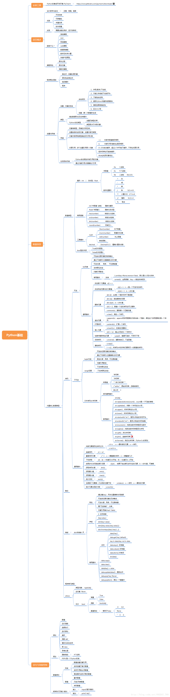

# Python 基础概述

> 一张 Python 基础知识体系的思维导图（微信导出图），用作学习路线索引与查漏补缺清单。

## 知识体系大纲

> 以下分支按导图主干整理，**细节以图为准**，后续可逐步展开成独立笔记。

- **基础语法**：变量与命名、数据类型（int/float/str/bool）、运算符、输入输出
- **流程控制**：条件分支（if/elif/else）、循环（for/while）、break/continue
- **数据结构**：列表、元组、字典、集合及其常用操作
- **函数**：定义与调用、参数（位置/默认/可变）、返回值、作用域、lambda
- **面向对象**：类与对象、属性与方法、继承、多态、魔术方法
- **模块与包**：import 机制、第三方库安装、`__name__` 作用
- **异常处理**：try/except/else/finally、raise、自定义异常
- **文件操作**：open 模式、读写、with 上下文管理、路径处理
- **常用标准库 / 第三方库**：os、sys、re、json、datetime、requests 等
- **高级特性**：推导式、迭代器与生成器、装饰器、闭包、上下文管理器

## 待办

- [ ] 逐分支补充细节笔记（每块可独立成篇，放入 `cs/dev/python/`）
- [ ] 补充分支标签或链接到已有笔记
