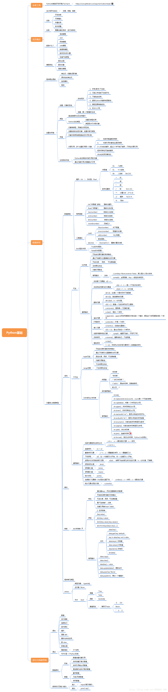

# Python 基础概述

> 一张 Python 基础知识体系的思维导图（微信导出图），用作学习路线索引与查漏补缺清单。

## 知识体系大纲

> 以下分支按导图主干整理，**细节以图为准**，后续可逐步展开成独立笔记。

- **基础语法**：变量与命名、数据类型（int/float/str/bool）、运算符、输入输出
- **流程控制**：条件分支（if/elif/else）、循环（for/while）、break/continue
- **数据结构**：列表、元组、字典、集合及其常用操作
- **函数**：定义与调用、参数（位置/默认/可变）、返回值、作用域、lambda
- **面向对象**：类与对象、属性与方法、继承、多态、魔术方法
- **模块与包**：import 机制、第三方库安装、`__name__` 作用
- **异常处理**：try/except/else/finally、raise、自定义异常
- **文件操作**：open 模式、读写、with 上下文管理、路径处理
- **常用标准库 / 第三方库**：os、sys、re、json、datetime、requests 等
- **高级特性**：推导式、迭代器与生成器、装饰器、闭包、上下文管理器

## 系列笔记（2026-10-15 从 `D:\Projects\Python\old` 提炼）

> **语言基础**留在本目录，按 01 → 04 顺序读；**场景方案**按「处理什么对象」分到 `data/`、`files/`、`web/`、`quality/`、`env/` 五个顶层目录，需要时直接查。两者互补：这里讲清语法，那边给出能抄的模板。

| 篇 | 内容 | 难度 |
| --- | --- | --- |
| [[01-速查手册]] | 变量/流程/数据结构/函数/推导式/内置函数/踩坑清单 | ★ |
| [[02-函数进阶]] | 递归 · 高阶函数 · 闭包 · 装饰器 · **深浅拷贝** | ★★★ |
| [[03-面向对象]] | 类/继承/多态 · classmethod/staticmethod · @property · `__new__` · 自定义异常 | ★★★ |
| [[04-for循环跳出]] | if 分支跳过 · continue · break · for-else 的适用边界 | ★ |
| 语言进阶 → | `advanced/`：装饰器与 `functools.wraps`、`*args`/`**kwargs`、迭代器协议与抽象基类 | ★★★ |
| 数据处理 → | `data/`：Excel/CSV、正则、numpy、出图、音视频，明细见 [[cs/dev/python/data/index\|data 索引]] | ★★ |
| Web 与抓取 → | [[cs/dev/python/web/01-Flask全链路\|web/01-Flask全链路]]，抓取见 `web/02-网页抓取` | ★★★ |
| 文件与工程 → | 文件整理在 `files/`；日志与异常在 `quality/`；环境与打包在 `env/` | ★★ |

> 另：`env/setup/`（Windows / WSL2 环境搭建）、`env/packaging/`（打包）。

## 待办

- [x] 逐分支补充细节笔记（2026-10-15 完成 5 篇，见上表）
- [ ] 迭代器 / 生成器 / 上下文管理器（3.x 高级特性，暂未成篇）
- [ ] asyncio 异步编程（需要时再补）
