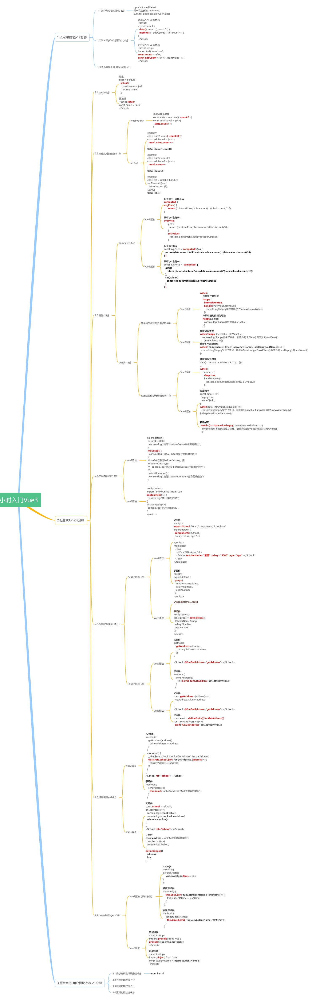

# Vue3 基础与组合式 API

> Vue2 → Vue3 的最小迁移闭环：**写法差异 / setup / 响应式 / computed / watch / 生命周期**。
> 每条都给了「Vue2 怎么写 → Vue3 怎么写」，看着旧代码迁移最省事。

## 一、先看清差在哪

| | Vue2（选项式 API） | Vue3（组合式 API） |
| --- | --- | --- |
| 代码组织 | `data` / `methods` / `computed` / `watch` 各占一块 | 一个 `setup` 里按**功能**聚在一起 |
| `this` | 处处 `this.xxx` | **没有 `this`**，直接引变量 |
| 响应式原理 | `Object.defineProperty` 劫持**已声明的属性** | `Proxy` 代理**整个对象** |
| 能监听到 | 只有 `data` 里一开始就有的 key | 新增/删除属性、数组下标赋值都能 |
| 模板根节点 | 必须单个根节点 | 可以多根（Fragment） |
| 销毁钩子 | `beforeDestroy` / `destroyed` | `beforeUnmount` / `unmounted` |

组合式 API 不是"新语法"，本质是**把同一份逻辑的变量和方法放在一起**，而不是按选项类型拆散。

## 二、起步

```bash
npm init vue@latest      # 官方脚手架（Vite）
# 或直接建：npm create vite@latest my-app -- --template vue
```

入口只有这一行（Vue2 是 `new Vue({ render: h => h(App) }).$mount('#app')`）：

```js
// main.js
import { createApp } from 'vue'
import App from './App.vue'

createApp(App).mount('#app')
```

## 三、setup：组合式 API 的入口

**① 原始写法 —— 必须 `return` 出去，模板才拿得到**

```js
export default {
  setup() {
    const name = 'jack'
    const showName = () => console.log(name)
    return { name, showName }   // 不 return，模板里是空的
  }
}
```

**② `<script setup>` 语法糖 —— 顶层声明的变量/函数自动暴露**

```vue
<script setup>
const name = 'jack'
const showName = () => console.log(name)
</script>

<template>
  <div>{{ name }}<button @click="showName">显示姓名</button></div>
</template>
```

> 语法糖下**不需要** `return`、**不需要** `components` 注册、`props/emits` 用宏声明（见 [[Vue3组件通信]]）。

**两个坑**

- `setup` 里**没有 `this`**，任何 `this.xxx` 都是 `undefined`。
- `setup` 执行时机比 `beforeCreate` 还早，**DOM 还不存在**，要操作 DOM 得放 `onMounted`。
- 原始写法第二个参数 `context` 提供 `attrs` / `slots` / `emit`。

## 四、响应式：`reactive` 和 `ref`

先记住反例 —— 普通变量改了**模板不会变**：

```js
let num = 0
const addNum = () => { num++ }      // 控制台变了，界面不动
```

### 4.1 `reactive`：管对象

```js
import { reactive } from 'vue'

const state = reactive({ count: 0 })
const addCount = () => { state.count++ }   // 直接点，不加 .value
```

### 4.2 `ref`：管一切

```js
import { ref } from 'vue'

const num = ref(0)
num.value++                     // JS 里必须 .value
// 模板：{{ num }}              ← 自动解包，不写 .value

const list = ref([1, 2, 3])
list.value.push(4)              // 数组也是 .value

const obj = ref({ count: 0 })
obj.value.count++               // ref 里塞对象，内部其实走 reactive
```

### 4.3 怎么选

| | `reactive` | `ref` |
| --- | --- | --- |
| 能装 | 对象 / 数组 / Map / Set | **任意类型**（含数字、字符串、布尔） |
| 访问 | `state.count` | JS 里 `num.value`；模板里 `num` |
| 整体替换 | ❌ 断链（见下） | ✅ `num.value = {...}` |
| 解构 | ❌ 丢响应性（用 `toRefs`） | ❌ 解构出来就是普通值 |
| 建议 | 一组相关字段 | **默认用 ref**（官方风格指南推荐） |

**三个必踩的坑**

1. **`reactive` 整体赋值会断链** —— 变量指向了新对象，模板还盯着旧对象：
   ```js
   let state = reactive({ count: 0 })
   state = reactive({ count: 10 })     // ❌ 界面不动
   Object.assign(state, { count: 10 }) // ✅
   ```
2. **`reactive` 解构丢响应性**：
   ```js
   const { count } = state            // ❌ count 是普通数字
   const { count } = toRefs(state)    // ✅ count 是 ref
   ```
3. **模板只解包"顶层" ref**，塞进数组/Map 里不会解包：
   ```js
   const arr = [ref(1)]
   // 模板 {{ arr[0] }} → 是 ref 对象，要写 arr[0].value
   ```

## 五、computed

```js
import { computed } from 'vue'

const totalPrice = ref(2000)
const amount = ref(10)
const discount = ref(8)

const avgPrice = computed(() => (totalPrice.value / amount.value) * (discount.value / 10))
```

可写计算属性（`get` / `set`）：

```js
const avgPrice = computed({
  get: () => (totalPrice.value / amount.value) * (discount.value / 10),
  set: (v) => { console.log('被赋值了', v) },      // 模板 v-model 或 JS 赋值时触发
})
```

**和 methods 的区别**：`computed` 有缓存，依赖不变就不重算；`methods` 每次渲染都执行。

> 注意：`computed` 返回值是**只读 ref**，JS 里读也要 `.value`（模板里自动解包）。

## 六、watch

```js
import { watch } from 'vue'

// ① 侦听单个 ref
watch(count, (newVal, oldVal) => console.log(newVal, oldVal))

// ② 侦听多个（数组 → 新值数组 / 旧值数组）
watch([a, b], ([newA, newB], [oldA, oldB]) => console.log(newA, newB))

// ③ 立即执行一次（Vue2 的 immediate）
watch(count, cb, { immediate: true })

// ④ 侦听整个对象（深监听）
watch(data, cb, { deep: true })

// ⑤ 精确侦听某个属性（只有它变才触发，性能更好）
watch(() => data.value.happy, (newVal, oldVal) => console.log(newVal, oldVal))
```

**深 / 浅的默认值不一样，这是最容易搞混的一点**

| 侦听源 | 默认深度 |
| --- | --- |
| `reactive` 对象 | **深**（嵌套改了也触发，`deep: true` 可省略） |
| `ref` 包的对象 | **浅**（`obj.value.x++` 不触发，必须 `deep: true`） |
| `() => obj.value.x` | 只盯这一个值 |

**`watchEffect`**：自动收集依赖 + 立即执行一次，不需要 `oldValue`，适合"依赖谁就自动盯谁"的场景。

```js
watchEffect(() => { console.log(count.value) })   // count 一变就打印
```

**停止侦听**：组件卸载自动停；手动停用返回值：

```js
const stop = watch(count, cb)
stop()
```

## 七、生命周期

| Vue2 | Vue3（选项式） | Vue3（组合式） |
| --- | --- | --- |
| `beforeCreate` | — | `setup()` 本身 |
| `created` | — | `setup()` 本身 |
| `beforeMount` | `beforeMount` | `onBeforeMount` |
| `mounted` | `mounted` | `onMounted` |
| `beforeUpdate` | `beforeUpdate` | `onBeforeUpdate` |
| `updated` | `updated` | `onUpdated` |
| `beforeDestroy` | `beforeUnmount` | `onBeforeUnmount` |
| `destroyed` | `unmounted` | `onUnmounted` |
| `activated` / `deactivated` | 同名 | `onActivated` / `onDeactivated` |

```vue
<script setup>
import { onMounted, onBeforeUnmount } from 'vue'

onMounted(() => console.log('挂载完成，可以拿 DOM'))
onMounted(() => console.log('同名钩子可以写多个'))   // 都会执行

onBeforeUnmount(() => console.log('即将卸载，清定时器/解绑事件'))
</script>
```

> 相比 Vue2 的一个好处：**同名钩子写多次都会执行**（Vue2 里会被后者覆盖）。
> 坑：钩子必须在 `setup` 顶层**同步**调用，放进 `setTimeout` / `if` 里不会注册。

## 八、坑清单

1. `ref` 在 **JS 里忘写 `.value`** —— 模板里反而不用写，来回切换最容易错。
2. `reactive` **解构 / 整体赋值**丢响应性。
3. 侦听 `ref` 包裹的对象忘了 `deep: true`。
4. `props` 是**只读**的，子组件想改必须 `emit` 给父组件（见 [[Vue3组件通信]]）。
5. `setup` 里用 `this`。
6. 想在 `setup` 里直接 `document.querySelector` —— 那时 DOM 还没生成。

## 附：课程全景导图



> 原图 3696×11294，这里压到 1500 宽（336 KB）。点开放大看细节。
