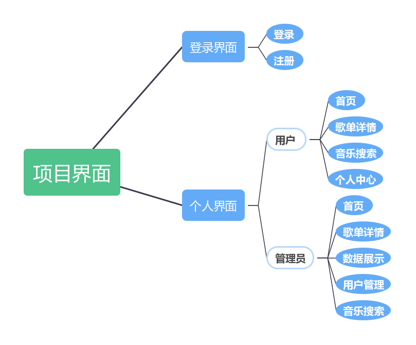

# Vue2 后台项目实战：音乐平台

> 课程大作业「河大emo聚集地」——Vue2 + element-ui + Flask + MySQL 的全栈小项目。
> 这里只留**能复用的东西**：分层架构、技术选型理由、登录态与动态路由权限。
> 原始材料：`D:\Projects\music-platform\music-web-vue2\`（答辩 PPT、课程大纲）；代码在 WSL `~/workspace/projects/music-platform/`。

## 一、四层架构

```
浏览器（用户操作界面）
   ↓ axios
前端服务器（vue-cli / webpack-dev-server，Vue2 SPA）
   ↓ HTTP + JSON
后端服务器（Flask，提供 REST 接口）
   ↓ pymysql
MySQL（存用户、歌单、歌曲数据）
```

拆成前后端分离的意义：前端只管渲染与交互，后端只管数据与业务，**接口是唯一的契约**。Vue2 项目一般起两个进程（8080 前端 / 5000 后端），靠 `CORS` 打通。

## 二、技术栈与"为什么用"

| 层 | 选型 | 解决什么 |
| --- | --- | --- |
| 框架 | Vue 2 | 数据驱动视图，不用手动操作 DOM |
| 状态 | Vuex | 跨组件共享（登录用户、播放状态） |
| 路由 | vue-router | SPA 页面切换、导航守卫做权限 |
| UI | element-ui | 后台管理成套组件（表格/表单/弹窗/分页） |
| 图表 | ECharts | 管理员端数据展示 |
| 样式 | less | 嵌套写法、变量 |
| 脚手架 | Vue CLI 3 | 开箱即用的 webpack 配置 |
| 后端 | Flask + CORS + pymysql | 轻量接口服务，直连 MySQL |

数据本身来自网易云音乐 API（`NeteaseCloudMusicApi`，Node 起一个本地服务转发），这也是这类课程项目的惯用做法 —— **不用自己爬，也不用自己造数据**。

## 三、页面结构



- **登录界面**：登录 / 注册
- **个人界面（普通用户）**：首页、歌单详情、音乐搜索、个人中心
- **个人界面（管理员）**：在上面基础上多出 **数据展示**、**用户管理**

角色差异不是靠 `v-if` 藏按钮，而是**路由本身就不同**（见下）。

## 四、核心知识点：登录态 + 动态路由权限

这是整个项目里最值得记的一段。

### 4.1 登录

- 页面：`el-dialog` 弹窗 + `el-form` 表单，提交前做 `rules` 校验
- 请求：`axios.post('/login', form)` → 后端校验后返回用户信息 + token
- 保存：token 写进 **cookie**（这样刷新页面还在，且能被导航守卫读到）
- 跳转：`this.$router.push('/home')`

### 4.2 导航守卫：没登录不许进

```js
// router/index.js
router.beforeEach((to, from, next) => {
  const token = getCookie('token')
  if (to.path === '/login') return next()          // 登录页放行
  if (!token) return next('/login')                // 没 token 一律回登录页
  next()
})
```

`beforeEach` 是**全局前置守卫**，每次路由跳转都会先过它一趟 —— 这是"用户第一次进来一定看到登录页"的实现方式。

### 4.3 动态路由：登录后再"挂"页面

静态路由（谁都能访问的：登录页、404）和动态路由（要登录、甚至要角色的）分开写：

```js
const constantRoutes = [ { path: '/login', ... }, { path: '/404', ... } ]

const asyncRoutes = [
  { path: '/home',    component: Home },
  { path: '/search',  component: Search },
  { path: '/user',    component: UserManage, meta: { roles: ['admin'] } },   // 只有管理员
  { path: '/data',    component: DataShow,   meta: { roles: ['admin'] } },
]
```

登录成功后（或守卫里发现"已登录但路由还没挂"时）按角色筛选，再逐个 `addRoute`：

```js
const routes = asyncRoutes.filter(r => !r.meta?.roles || r.meta.roles.includes(role))
routes.forEach(r => router.addRoute(r))

next({ ...to, replace: true })   // ⚠️ 关键：重新进一次，否则首次跳转会白屏
```

**为什么这招比 `v-if` 藏菜单更靠谱**：菜单可以藏，但用户能直接在地址栏敲 `/user`。动态路由的页面**根本没注册进路由器**，敲 URL 只会命中 404 —— 这才是真正的"访问不到"。

**最容易踩的坑**：`addRoute` 之后必须 `next({ ...to, replace: true })` 重新触发一次导航。因为本次跳转的路由表在导航开始时就已经匹配完了，新加的路由不会自动生效。

### 4.4 补充：接口层的统一处理

`axios` 加拦截器，`401 / token 过期` 时清 cookie 并踢回登录页，避免每个页面各写一遍。

## 五、可以带走的经验

1. **角色权限 = 路由级 + 接口级，不能只做菜单级。** 前端藏入口只防手滑，不防手敲。
2. **`addRoute` 后必须重新导航**，这是 Vue2/Vue3 通用的坑。
3. **登录态放 cookie/localStorage 而不是 Vuex** —— Vuex 刷新即失，cookie 才是可恢复的。
4. **弹窗 + 表单**是后台登录/新增的标准组合，`el-form` 的 `rules` + `ref.validate()` 比手写校验省事。
5. 前后端分离项目**先定接口格式**（`{code, msg, data}`）再动工，比边写边改省一半返工。
